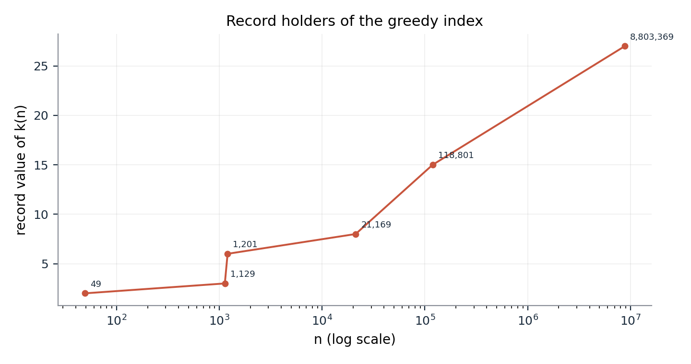

# ERDOS-GREEDY-AGENT

**An autonomous experimental-mathematics agent for greedy obstructions in the
Erdős–Straus equation.**

[](https://www.python.org/)
[](LICENSE)
[](report/report.pdf)

> **TL;DR.** Instead of asking whether `4/n = 1/x + 1/y + 1/z` has *some*
> solution, the agent studies the **first success of the simplest greedy
> search**.  It proves an exact first-step criterion, scans `n ≤ 2×10⁷` with
> zero false positives/negatives, finds the record `k(8,803,369) = 27`, and
> discovers a CRT mechanism that makes the greedy witness height unbounded
> along an explicit congruence class.

This repository contains the agent, the recorded run, the full audit trail,
the generated figures, and the [PDF report](report/report.pdf) (Chinese, with
an English abstract).

---

## Key results

| Result | Statement |
|---|---|
| **Theorem 1** | `k(n) > 1` **iff** every prime factor of `n` and of `⌊(n+3)/4⌋` is `≡ 1 (mod 3)`. |
| **Corollary** | Every first-step failure satisfies `n ≡ 1 (mod 12)`. |
| **Audit** | On `2 ≤ n ≤ 2×10⁷`: 153,916 positives, 19,846,083 negatives, **0 FP / 0 FN**. |
| **Record** | `k(8,803,369) = 27` (previous record in this run: `k(118,801) = 15`). |
| **Height** | `z(767,761) ≈ 8.79×10¹⁹`, i.e. `z/n³ ≈ 194.3`; for `n ≡ 9 (mod 19), n ≡ 33 (mod 52)`, `z/n³ = (n+19)(n²+19n+52)/(3952 n²) → ∞`. |
| **Conjectures** | `k(n)` is unbounded; `z(n)/n³` is unbounded; record holders `> 49` are prime. |

The full proof, the 14-step agent trace, all certificates, and the discussion
of the conjectures are in **[report/report.pdf](report/report.pdf)**.



---

## What is the agent?

`ERDOS-GREEDY-AGENT` is a deterministic, auditable research loop:

```
observe  ->  hypothesise  ->  design experiment  ->  execute + certificate
   ^                                                        |
   +---------------  reflect & update beliefs  <------------+
```

It is **not** an LLM wrapper.  Its reasoning state is explicit:

- **Beliefs**: nine hypotheses (`H0` … `H8`) with status
  `proposed / supported / refuted / theorem` and evidence.
- **Tools**: range scanner, finite-group step certificate, exact witness
  builder, generic feature library, beam-search conjunction learner, record
  anatomy, height scanner, growth-model fitter.
- **Audit trail**: every step is written to `trace.jsonl` with
  thought → action → observation, and every numerical claim can be reproduced.

The agent is deliberately small and dependency-light: the mathematical core is
standard-library Python; `matplotlib` is used only to render figures.

### The certificate in one paragraph

For a fixed `n ≡ 1 (mod 4)` and step `j`, put `x = (n+4j−1)/4`, `a = 4j−1`,
`b = nx`, `g = gcd(a,b)`, `p = a/g`, `q = b/g`.  Then

```
4/n = 1/x + 1/y + 1/z   <=>   (p y − q)(p z − q) = q²
```

so the step succeeds iff some divisor `d | q²` satisfies `d ≡ −q (mod p)`.
After shifting by `q`, this is a finite-group membership test: does `−1` lie in
the set of reachable divisor residues `S_j`?  This is why `2×10⁷` is reachable
in seconds instead of searching over `y, z`.

---

## Quick start

### Requirements

- Python ≥ 3.10
- `matplotlib` (figures only)

```bash
python -m pip install -r requirements.txt
```

### Run the recorded campaign

Linux/macOS:

```bash
export PYTHONPATH=src
python -m es_agent.cli run --n-max 20000000 --out runs/main
```

Windows PowerShell:

```powershell
$env:PYTHONPATH = "src"
python -m es_agent.cli run --n-max 20000000 --out runs/main
```

Typical runtime: **~84 s** single-process, ~1 GB peak memory.  A small demo:

```bash
python -m es_agent.cli run --n-max 200000 --out runs/demo
```

### Rebuild the report

```bash
cd report
latexmk -xelatex report.tex
```

The checked-in PDF is `report/report.pdf` (20 pages).

### Tests

```bash
python -m unittest discover -s tests -v
```

The suite covers:

- exact witness verification for `n ≤ 500`,
- known records,
- the `n ≡ 1 (mod 12)` corollary,
- the conjunction learner,
- an end-to-end small agent campaign.

---

## Repository layout

```
.
├── src/es_agent/
│   ├── domain.py        # greedy step, finite-group certificate, witness, scan
│   ├── rules.py         # generic features + beam-search conjunction learner
│   ├── analysis.py      # rule audit, record certificates, heights, growth fits
│   ├── agent.py         # belief state, agenda, 14-step campaign, trace
│   ├── plotting.py      # figures
│   └── cli.py           # `python -m es_agent.cli`
├── runs/main/           # recorded run: summary.json, trace.jsonl, trace.md, figures
├── data/                # small scan / height summaries
├── report/              # LaTeX source, PDF, figures
├── tests/               # unittest suite
├── docs/                # short mathematical notes
├── README.md
├── LICENSE
├── requirements.txt
└── pyproject.toml
```

## Recorded run at a glance

| item | value |
|---|---|
| range | `2 ≤ n ≤ 20,000,000` |
| trace steps | 14 |
| elapsed | 83.56 s |
| exact calibration | 4,999 witnesses, 0 mismatches |
| brute-force cross-check | `n ≤ 1500`, 0 mismatches |
| rule audit | 0 FP / 0 FN |
| max `k(n)` | 27 at `n = 8,803,369` |
| max `z/n³` | 194.281 at `n = 767,761` |

The run is deterministic: rerunning the command above on the same Python
version reproduces the same trace and summary.

---

## Mathematical status (important)

- **Proved here**: Theorem 1 and the CRT height formula (Proposition 6.4).
- **Finite audit**: the rule and the records are verified up to `2×10⁷`.
- **Open / conjectural**: unboundedness of `k(n)`, unboundedness of
  `z(n)/n³`, and the record-prime conjecture.

Nothing in this repository solves the Erdős–Straus conjecture.  The point is a
reusable *experimental pipeline*: the agent discovers structure, the
certificates keep it honest, and the open part is stated explicitly.

---

## 中文摘要

本项目开发了一个自主实验数学智能体，用于研究 Erdős–Straus 方程
`4/n = 1/x + 1/y + 1/z` 的“贪心障碍”。智能体从最小可行分母开始逐步尝试，
用有限群除子证书判定每一步，并在 `n ≤ 2×10⁷` 上完成零反例审计。

- **定理**：首步失败当且仅当 `n` 与 `⌊(n+3)/4⌋` 的所有素因子都
  `≡ 1 (mod 3)`；推论：失败只在 `n ≡ 1 (mod 12)`。
- **记录**：`k(8,803,369) = 27`。
- **高度机制**：沿 `n ≡ 9 (mod 19)`、`n ≡ 33 (mod 52)`，
  `z/n³ = (n+19)(n²+19n+52)/(3952n²) → ∞`。
- **开放猜想**：`k(n)` 无界、`z(n)/n³` 无界、记录持有者最终为素数。

完整的 14 步运行轨迹、证明、图表与可复现命令见
[report/report.pdf](report/report.pdf)。

---

## Citation

If you use this code or the data, please cite the report:

```bibtex
@misc{erdosgreedyagent2026,
  title  = {ERDOS-GREEDY-AGENT: An Autonomous Agent for Greedy Obstructions
            in the Erd\H{o}s--Straus Equation},
  author = {ERDOS-GREEDY-AGENT},
  year   = {2026},
  note   = {Code and report: https://github.com/studytohard/erdos-greedy-agent}
}
```

## License

MIT — see [LICENSE](LICENSE).
